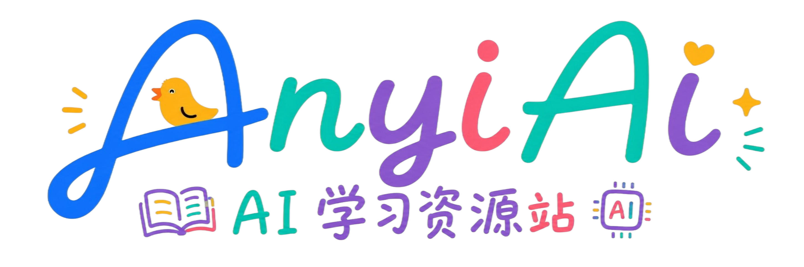
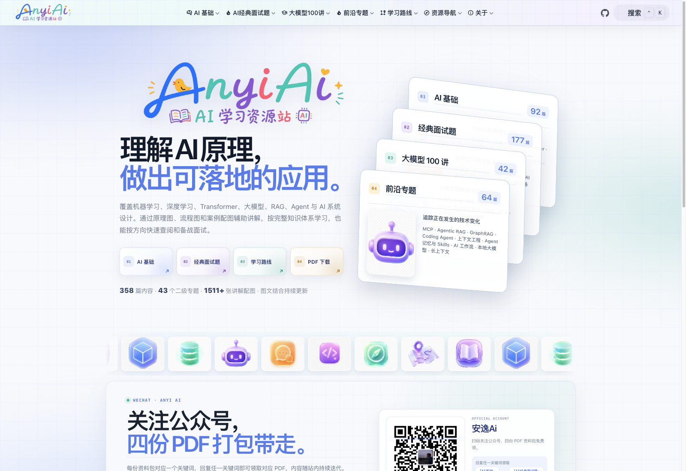
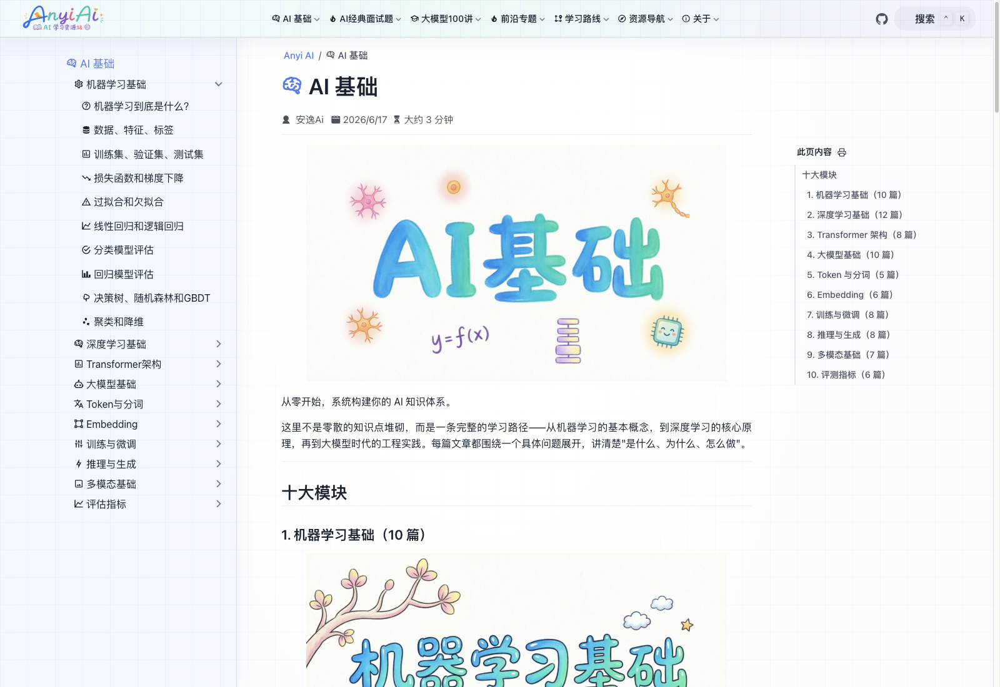
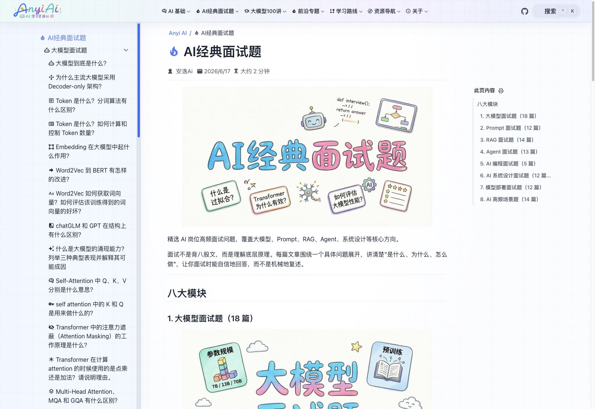
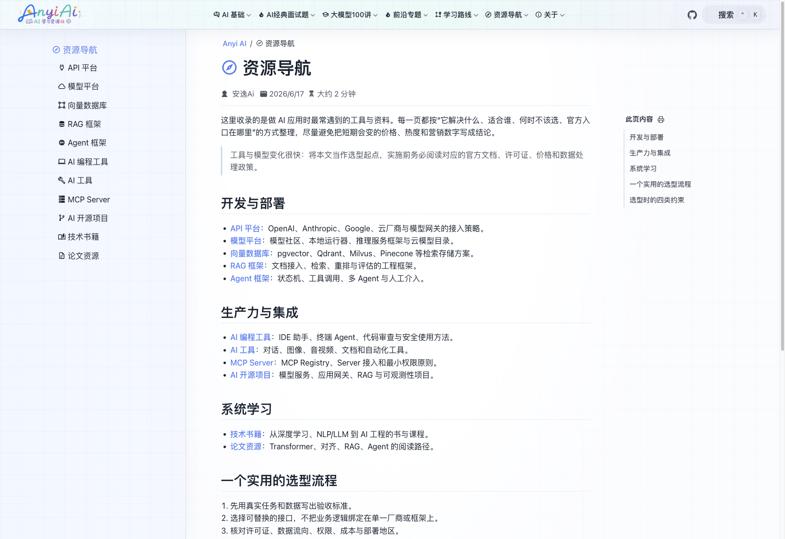

<p align="center">
  
</p>

<h1 align="center">Anyi Ai Learn</h1>

<p align="center">一个专注于 AI 领域的学习导航站，旨在帮助开发者系统性地掌握 AI 技术栈</p>

<p align="center">
  <a href="https://www.anyiai.cc">🌐 在线访问</a> ·
  <a href="https://github.com/Easesgr/anyiai-docs">📦 GitHub</a> ·
  <a href="#网站预览">🖼️ 网站预览</a> ·
  <a href="#内容板块">📚 内容板块</a> ·
  <a href="#本地开发">💻 本地开发</a> ·
  <a href="#关注公众号">📱 关注公众号</a>
</p>

---

## 简介

Anyi Ai Learn 是一个免费开源的 AI 学习资源站点，内容覆盖从机器学习基础到大模型应用开发的完整知识体系。每篇文章围绕一个具体问题展开，讲清楚"是什么、为什么、怎么做"。

内容、配图和网站源码在此仓库持续更新，欢迎纠错、补充学习资料和参与建设。

## 网站预览

以下截图来自 [www.anyiai.cc](https://www.anyiai.cc/)，拍摄于 2026-10-28。

### 首页



### AI 基础



### AI 经典面试题



### 资源导航



## 内容板块

| 板块 | 内容 | 在线阅读 |
|------|------|----------|
| AI 基础 | 机器学习、深度学习、Transformer、大模型、Token、Embedding、训练、推理、多模态与评估 | [进入](https://www.anyiai.cc/fundamentals/) |
| AI 经典面试题 | 大模型、Prompt、RAG、Agent、AI 编程、系统设计、部署与高频场景 | [进入](https://www.anyiai.cc/interview/) |
| 大模型 100 讲 | 大模型原理、提示词工程、RAG、Agent、微调、应用系统与部署 | [进入](https://www.anyiai.cc/llm-100/) |
| 前沿专题 | MCP、Agent Skills、Agentic RAG、GraphRAG、上下文工程与 AI 工作流 | [进入](https://www.anyiai.cc/frontier/) |
| 学习路线 | 从原理到 AI 工程、AI 面试备战等目标导向的学习路径 | [进入](https://www.anyiai.cc/learning-path/) |
| 资源导航 | API 平台、模型平台、向量数据库、RAG 与 Agent 框架、AI 工具、论文与书籍 | [进入](https://www.anyiai.cc/resources/) |

## 技术栈

- **框架**：VuePress 2
- **主题**：vuepress-theme-hope
- **包管理**：pnpm
- **构建**：Vite
- **自动部署**：GitHub Actions 构建并推送到 `gh-pages` 分支

## 本地开发

使用 Node.js 24 和 pnpm 10.33.0。图片资源较多，首次克隆和构建需要一定磁盘空间。

```bash
# 克隆仓库
git clone https://github.com/Easesgr/anyiai-docs.git
cd anyiai-docs

# 安装指定版本的 pnpm
npm install --global pnpm@10.33.0

# 安装依赖
pnpm install --frozen-lockfile

# 启动开发服务器
pnpm docs:dev

# 构建生产版本
pnpm docs:build

# 清除缓存后启动
pnpm docs:clean-dev
```

生产构建输出位于 `src/.vuepress/dist/`。

### PDF 导出

```bash
# 首次使用时安装浏览器
pnpm exec playwright install chromium

# 查看可导出的专题
pnpm docs:pdf --list

# 导出全部专题，默认输出至 output/pdf/
pnpm docs:pdf
```

### 部署配置

推送 `main` 后，`.github/workflows/deploy-docs.yml` 会安装锁定依赖、构建站点并更新 `gh-pages` 分支。使用 GitHub Pages 托管时，需要另行在仓库 Settings → Pages 中选择发布来源，并配置自己的域名。

Fork 后请修改 `src/.vuepress/theme.ts` 中的 `hostname`、`repo`、作者信息，以及 `src/.vuepress/config.ts` 中的网站信息。当前站点使用根路径 `/`；如果部署到 GitHub Pages 的项目子路径，还需调整 `base` 和静态资源路径。

可选配置：`GOOGLE_SITE_VERIFICATION` 用于构建时输出 Google 验证标签；`BAIDU_PUSH_TOKEN` 通过 GitHub Actions 仓库 Secret 配置，用于部署后提交更新页面。不配置百度 Token 时，工作流会跳过提交。

本地环境文件、明文阅读码、缓存、浏览器记录、原始素材和 PDF 导出不纳入版本控制。阅读组件使用的哈希配置会随前端发布，可按需修改 `src/.vuepress/readmore.config.ts`。

## 项目结构

```
anyi-docs/
├── src/
│   ├── .vuepress/
│   │   ├── config.ts          # VuePress 配置
│   │   ├── theme.ts           # 主题配置
│   │   ├── navbar/            # 导航栏配置
│   │   ├── sidebar/           # 侧边栏配置
│   │   ├── styles/            # 自定义样式
│   │   ├── components/        # 自定义组件
│   │   ├── readmore.config.ts # 阅读锁定配置
│   │   └── public/            # 静态资源
│   ├── fundamentals/          # AI 基础
│   ├── interview/            # AI 经典面试题
│   ├── llm-100/              # 大模型 100 讲
│   ├── frontier/              # 前沿专题
│   ├── learning-path/        # 学习路线
│   ├── projects/             # 实战项目
│   ├── architecture/         # AI 系统架构
│   ├── resources/             # 资源导航
│   └── about/                 # 关于
├── docs/screenshots/         # 网站实景截图
├── scripts/export-pdfs.mjs   # PDF 导出脚本
├── .github/workflows/        # 自动构建与部署
├── package.json
└── README.md
```

## 内容风格

- **说人话**：不堆公式，不拽术语，用大白话讲清楚原理
- **有问题导向**：每篇文章围绕一个具体问题展开
- **有体系**：模块之间有逻辑关系，学习路径清晰
- **能落地**：不只是理论，还有实战建议和选型指南

## 关注公众号

扫描下方二维码关注微信公众号 **安逸Ai**，获取更多 AI 学习资料和更新通知。

<p align="center">
  
</p>

## 贡献

欢迎提交 Issue 和 Pull Request。新增或调整文章时，请同步维护导航和侧边栏，并在提交前运行 `pnpm docs:build`。

## 许可证

[MIT License](LICENSE)
